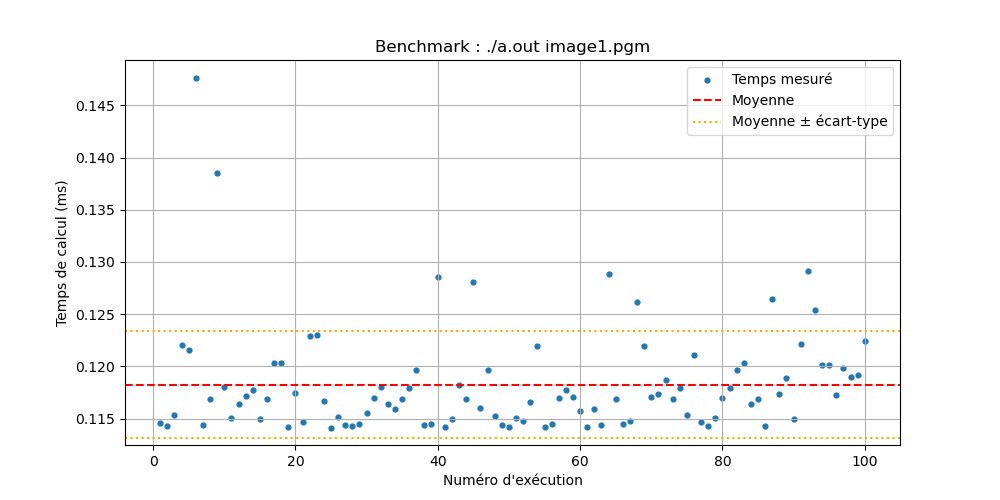
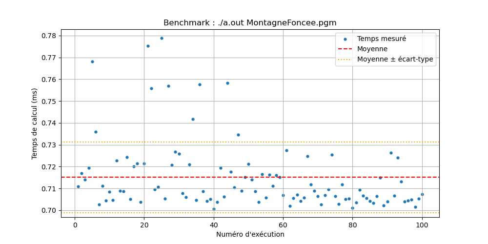

# Compte rendu d'évaluation de performances

Réalisé par LEVACHER Ethan en IAI3 dans le cadre des cours de Processeurs pour le multimédia.

## Sommaire

- [Méthodologie commune](#méthodologie-commune)
- [TP1 — Réhaussement d'image](#tp1--réhaussement-dimage)

---

## Méthodologie commune

Pour chaque TP, le programme est exécuté N fois (100 par défaut) avec le script
[`tools/benchmark.py`](tools/benchmark.py).
On relève la moyenne, l'écart-type, le minimum et le maximum ; les données brutes (CSV)
et les graphiques sont dans le dossier `results/` de chaque TP.

La configuration de la machine est relevée au moment des mesures avec
[`tools/systeme_info.sh`](tools/systeme_info.sh).

---

## TP1 — Réhaussement d'image

Code : [`TP1/src/rehaussement.c`](TP1/src/rehaussement.c)

Le programme analysé permet le réhaussement de contraste d'image. Pour ce faire, on utilise le format .pgm, un format d'image dans lequel les pixels sont représentés sous forme de texte, ce qui facilite le debug.

L'idée est de trouver la valeur minimum et maximum des pixels, puis de représenter le minimum par 0 et le maximum par 255, en mettant tous les autres pixels à l'échelle.

### Environnement de test

Les tests de performances ont été réalisés le 02/11/26 sur un PC de l'ENSSAT avec comme caractéristiques
([détail complet](TP1/results/MontagneFoncee/system_info.txt)) :
- OS : Linux crook-a-16 7.0.0-38-generic
- Processeur : Intel(R) Core(TM) Ultra 5 235, 14 cœurs
- RAM : 15 Gi
- Compilateur : gcc (Ubuntu 13.3.0-6ubuntu2~24.04.1) 13.3.0

### Performance séquentielle

Pour le fichier `image1.pgm`, sur 100 exécutions, nous obtenons une moyenne de 0.119 ms, avec un écart-type de 0.005 ms. Le temps d'exécution minimum est 0.114 ms et le temps d'exécution maximum est 0.147 ms.

Pour le fichier `MontagneFoncee.pgm`, sur 100 exécutions, nous obtenons une moyenne de 0.715 ms, avec un écart-type de 0.016 ms. Le temps d'exécution minimum est 0.700 ms et le temps d'exécution maximum est 0.779 ms.

| Image | Exécutions | Moyenne | Écart-type | Min | Max |
|-------|-----------:|--------:|-----------:|----:|----:|
| image1.pgm | 100 | 0.119 ms | 0.005 ms | 0.114 ms | 0.147 ms |
| MontagneFoncee.pgm | 100 | 0.715 ms | 0.016 ms | 0.700 ms | 0.779 ms |

### Performance parallélisée

*TODO*
