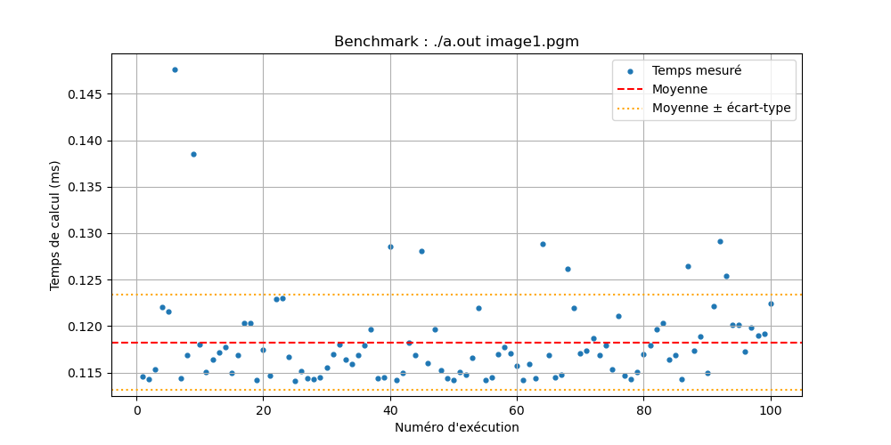
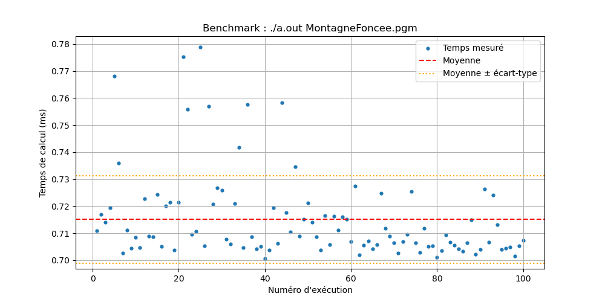

# Compte rendu d'évaluation de performances

Réalisé par LEVACHER Ethan en IAI3 dans le cadre des cours de Processeurs pour le multimédia.

## Sommaire

- [Méthodologie commune](#méthodologie-commune)
- [TP1 — Réhaussement d'image](#tp1--réhaussement-dimage)

---

## Méthodologie commune

Pour chaque TP, le programme est exécuté N fois (100 par défaut) avec le script
[`tools/benchmark.py`](tools/benchmark.py).
On relève la moyenne, l'écart-type, le minimum et le maximum ; les données brutes (CSV)
et les graphiques sont dans le dossier `results/` de chaque TP.

La configuration de la machine est relevée au moment des mesures avec
[`tools/systeme_info.sh`](tools/systeme_info.sh).

---

## TP1 — Réhaussement d'image

Code : [`TP1/src/rehaussement.c`](TP1/src/rehaussement.c)

Le programme analysé permet le réhaussement de contraste d'image. Pour ce faire, on utilise le format .pgm, un format d'image dans lequel les pixels sont représentés sous forme de texte, ce qui facilite le debug.

L'idée est de trouver la valeur minimum et maximum des pixels, puis de représenter le minimum par 0 et le maximum par 255, en mettant tous les autres pixels à l'échelle.

### Environnement de test

Les tests de performances ont été réalisés le 02/11/26 sur un PC de l'ENSSAT avec comme caractéristiques
([détail complet](TP1/results/MontagneFoncee/system_info.txt)) :
- OS : Linux crook-a-16 7.0.0-38-generic
- Processeur : Intel(R) Core(TM) Ultra 5 235, 14 cœurs
- RAM : 15 Gi
- Compilateur : gcc (Ubuntu 13.3.0-6ubuntu2~24.04.1) 13.3.0

### Performance séquentielle

Pour le fichier `image1.pgm`, sur 100 exécutions, nous obtenons une moyenne de 0.119 ms, avec un écart-type de 0.005 ms. Le temps d'exécution minimum est 0.114 ms et le temps d'exécution maximum est 0.147 ms.



Pour le fichier `MontagneFoncee.pgm`, sur 100 exécutions, nous obtenons une moyenne de 0.715 ms, avec un écart-type de 0.016 ms. Le temps d'exécution minimum est 0.700 ms et le temps d'exécution maximum est 0.779 ms.



| Image | Exécutions | Moyenne | Écart-type | Min | Max |
|-------|-----------:|--------:|-----------:|----:|----:|
| image1.pgm | 100 | 0.119 ms | 0.005 ms | 0.114 ms | 0.147 ms |
| MontagneFoncee.pgm | 100 | 0.715 ms | 0.016 ms | 0.700 ms | 0.779 ms |

### Parallélisation

Nous allons maintenant utiliser les instructions AVX pour paralléliser le traitement des pixels. Contrairement à la version séquentielle, qui traite les pixels un par un, AVX permet d'appliquer la même opération à plusieurs valeurs à la fois grâce aux registres de 256 bits.

Pour pouvoir charger plusieurs pixels d'un coup, l'image est d'abord copiée dans un tableau 1D contigu. Les derniers pixels, si leur nombre n'est pas un multiple de la taille d'un paquet, sont traités par une petite boucle classique.

#### AVX Float

Nous utilisons d'abord le type `float`, simple à manipuler avec AVX grâce au type `__m256`.

Un `float` occupe 32 bits : nous pouvons donc traiter 8 pixels à la fois dans un registre de 256 bits. AVX fournit directement toutes les opérations nécessaires sur les flottants (min, max, soustraction, multiplication), ce qui rend cette version simple à écrire. En revanche, 8 bits suffisent pour un pixel (0 à 255), donc cette version utilise 4 fois plus de mémoire que nécessaire.

#### AVX Short

Nous utilisons ensuite des `unsigned short`. Un `short` occupe 16 bits, ce qui permet de traiter 16 pixels dans un registre `__m256i`, avec deux fois moins de mémoire que les `float`. Les calculs sur entiers dans des registres de 256 bits nécessitent AVX2 (option `-mavx2`).

La difficulté est la multiplication par le facteur de contraste : c'est un nombre à virgule, et AVX ne sait pas multiplier des entiers par un flottant. Nous utilisons donc la virgule fixe : le facteur est représenté par l'entier `facteur × 256`, et l'instruction `_mm256_mulhi_epu16` (qui garde les 16 bits de poids fort du produit) donne directement `(pixel − min) × facteur`. Comme le facteur est arrondi, certains pixels peuvent différer d'un niveau de gris de la version séquentielle.

#### AVX Char

Enfin, nous utilisons des `unsigned char`, qui occupent seulement 8 bits. Cela permet de traiter 32 pixels dans un seul registre `__m256i`.

Il est important d'utiliser `unsigned char` plutôt que `char` : un `char` signé ne peut représenter que les valeurs de −128 à 127, alors que nos pixels peuvent atteindre 255. Pour la même raison, nous utilisons les instructions non signées `_mm256_min_epu8` et `_mm256_max_epu8`.

AVX2 n'a pas d'instruction de multiplication sur 8 bits. Nous considérons donc le registre comme 16 `short` contenant chacun 2 pixels, que nous séparons avec un décalage et un masque. Chaque multiplication 16 bits ne concerne ainsi qu'un seul pixel. Nous recollons ensuite les deux résultats.

Cette représentation est la plus intéressante : elle correspond exactement à la taille d'un pixel et traite le plus de pixels par instruction.

### OpenMP

Après AVX, nous parallélisons notre code avec OpenMP. OpenMP permet de répartir l'exécution d'un programme sur plusieurs threads, de manière simple, grâce à des directives `#pragma`.

Par exemple, pour calculer le maximum d'un tableau en parallèle :

```c
int max = 0;
#pragma omp parallel for reduction(max:max)
for (int i = 0; i < n; i++)
    max = MAX(max, tab[i]);
```

`parallel for` crée les threads et leur répartit les itérations de la boucle. La clause `reduction(max:max)` donne à chaque thread sa propre copie de `max`, puis combine les résultats à la fin. Sans elle, tous les threads écriraient en même temps dans la même variable et le résultat pourrait être faux.

Comme on peut le voir, toute la gestion des threads (création, répartition du travail, attente de la fin) se fait automatiquement.

Dans notre cas, nous parallélisons les deux parties du programme : la recherche du min et du max (avec `reduction`), puis le rehaussement lui-même (avec un simple `parallel for`). Dans les deux cas, il s'agit de boucles `for` dont chaque itération est indépendante des autres.

